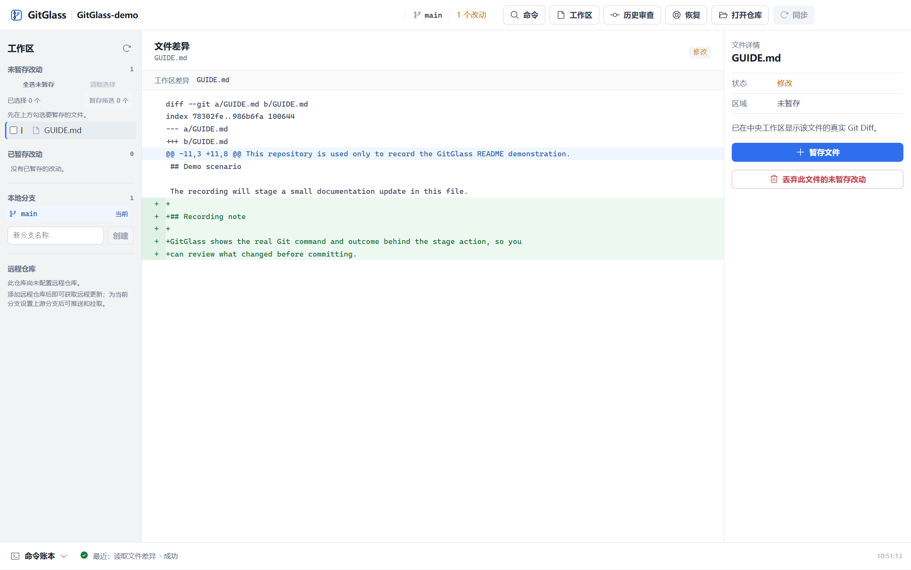
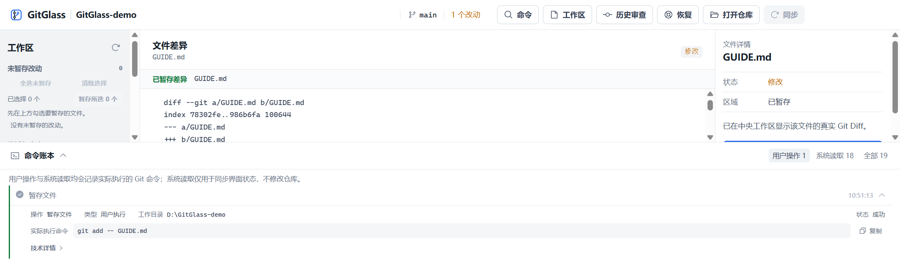

<p align="center">
  
</p>

<h1 align="center">GitGlass</h1>

<p align="center"><strong>Review every Git action before it changes your repository.</strong></p>

<p align="center">A local-first desktop Git workspace for inspecting real commands, reviewing changes, and committing with confidence.</p>

<p align="center">English | <a href="README.zh-CN.md">简体中文</a></p>

<p align="center"><a href="https://github.com/chukui2005/GitGlass/releases">View beta builds on Releases</a></p>

<!-- section:hero -->



Start with a familiar review flow: select a changed file, inspect its real Git Diff, then decide what to stage.

<!-- section:why-gitglass -->

## Why GitGlass

- **Command Ledger.** Review the Git argv actually run, working directory, stdout, stderr, exit code, and whether the operation came from you or the system.
- **Deliberate safety boundaries.** Risky actions follow a plan, confirmation, and revalidation flow. GitGlass does not silently force-push, run `reset --hard`, or rebase.
- **History for review.** Read commit details and real Diffs, compare commits, follow file history, and filter history without changing the working tree.
- **Local first.** GitGlass calls your locally installed Git. It does not upload Git operations or repository content to a cloud service.

<!-- section:features -->

## Features

### Transparent execution

- Inspect user actions and background reads in the Command Ledger.
- See the exact argv, working directory, output, errors, and exit status for an execution.
- Copy commands and diagnostic output from an individual ledger entry.

### Everyday workspace

- Review working-tree and staged file status with real Git Diffs.
- Stage, unstage, and batch-select tracked changes before committing.
- Create commits and inspect local branches from one workspace.

### History and review

- Read recent commits, statistics, changed files, and full Diffs.
- Compare two commits in a fixed base-to-target direction.
- Filter history by keyword, author, local branch, and tracked file; inspect a file's history.

### Safety and recovery

- Preview and confirm normal Fetch, Push, and `pull --ff-only` operations.
- Discard only one tracked, unstaged file after reviewing its Diff and typing its name.
- Delete merged non-current local branches and create rescue branches from reflog entries.

### Current beta limits

- Windows x64 Beta only. You must install Git yourself and make `git` available on the command line.
- GitGlass does not support force push, remote-branch deletion, automatic merge, rebase, stash, or `reset --hard`.
- The first Beta is unsigned; Windows SmartScreen may show an “Unknown publisher” warning.

<!-- section:download -->

## Download and install

<!-- release-link: replace this Releases-page link with versioned asset links after publication -->

Beta builds will be published on the [Releases page](https://github.com/chukui2005/GitGlass/releases). Until a release is published, use that page rather than a guessed version-specific URL.

### NSIS installer

1. Download the Windows installer from the Releases page.
2. Run it and choose an installation directory if needed.
3. Start GitGlass from the Start menu or the desktop shortcut.

### ZIP package

1. Download the Windows ZIP package from the Releases page.
2. Extract it to a folder you control.
3. Double-click `GitGlass.exe`.

### Git prerequisite

Confirm Git is available before opening a repository:

```powershell
git --version
```

If Git is missing, GitGlass will prompt you to install Git. GitGlass does not bundle Git.

<!-- section:screenshots -->

## Command Ledger



After a user action, the Command Ledger keeps the actual command, its source, working directory, result, and exit status available for review. Technical output stays collapsed unless you need it.

<!-- section:development -->

## Development

```powershell
npm install
npm run dev
```

For deeper material, see [Architecture](ARCHITECTURE.md), [Design v2](DESIGN_V2.md), [QA report](QA_REPORT.md), [release instructions](docs/RELEASING.md), and [contributing](CONTRIBUTING.md).

<!-- section:security -->

## Security boundaries

GitGlass uses the Git installed on your machine, and the Command Ledger makes each executed command reviewable. It does not collect, upload, or host repository content. Please report security concerns through [GitHub Issues](https://github.com/chukui2005/GitGlass/issues).

<!-- section:license -->

## License

Licensed under the [Apache License 2.0](LICENSE).
