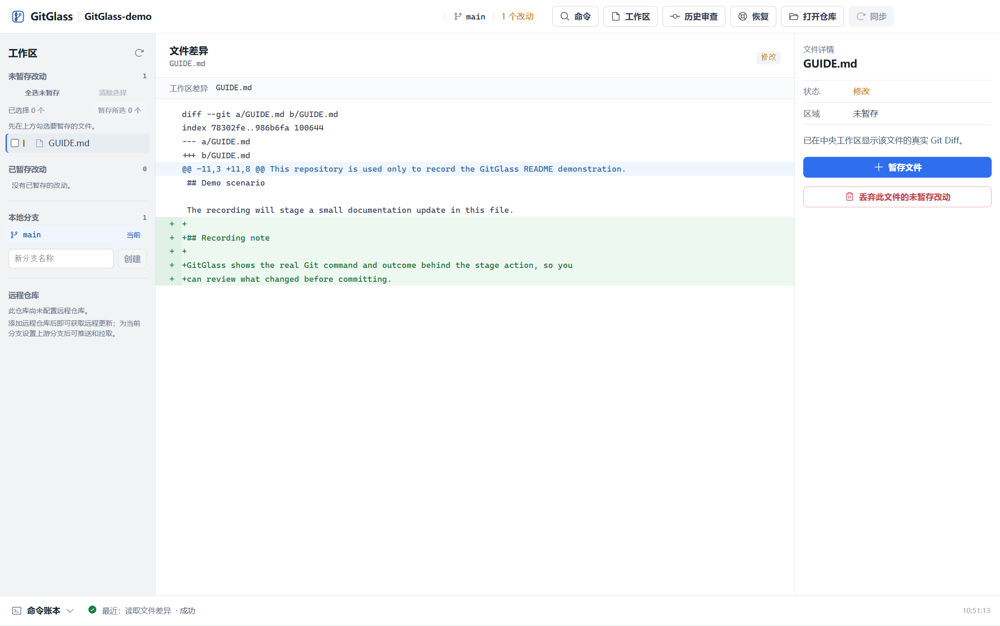
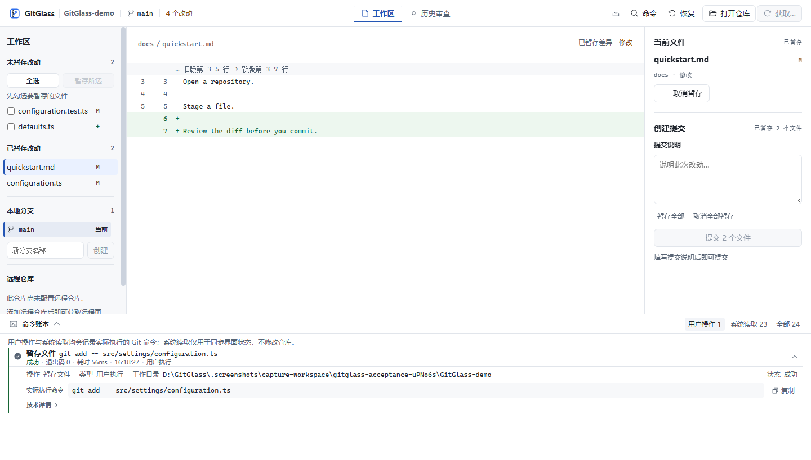

<p align="center">
  
</p>

<h1 align="center">GitGlass</h1>

<p align="center"><strong>每一次 Git 改变仓库前，都值得先看清它。</strong></p>

<p align="center">GitGlass 是本地优先的桌面 Git 工作台：审阅真实命令、检查改动，再安心提交。</p>

<p align="center"><a href="README.md">English</a> | 简体中文</p>

<p align="center"><a href="https://github.com/chukui2005/GitGlass/releases">在 Releases 页面查看 Beta 安装包</a></p>

<!-- section:hero -->



从熟悉的审阅流程开始：选中改动文件、查看真实 Git Diff，再决定是否暂存。

<!-- section:why-gitglass -->

## 为什么选择 GitGlass

- **命令账本。** 审阅实际执行的 Git argv、工作目录、stdout、stderr、退出码，以及操作来自用户还是系统读取。
- **明确的安全边界。** 有风险的操作遵循“计划、确认、再校验”流程；GitGlass 不会悄悄执行 force push、`reset --hard` 或 rebase。
- **面向审阅的历史记录。** 查看提交详情和真实 Diff、比较提交、跟踪文件历史，并在不改变工作区的前提下筛选历史。
- **本地优先。** GitGlass 调用用户本机安装的 Git，不会把 Git 操作或仓库内容上传到云端。

<!-- section:features -->

## 功能概览

### 透明执行

- 在命令账本中审阅用户操作和后台读取。
- 查看一次执行的准确 argv、工作目录、输出、错误与退出状态。
- 从单条账本记录复制命令和诊断输出。

### 日常工作区

- 通过真实 Git Diff 查看工作区和暂存区的文件状态。
- 在提交前暂存、取消暂存，或批量选择已跟踪的改动。
- 在同一个工作区创建提交并查看本地分支。

### 历史与审阅

- 查看近期提交、统计、改动文件与完整 Diff。
- 以固定的“基准到对比”方向比较两个提交。
- 按关键词、作者、本地分支和已跟踪文件筛选历史，并查看文件历史。

### 安全与恢复

- 预览并确认常规 Fetch、Push 与 `pull --ff-only` 操作。
- 仅在查看 Diff 并输入文件名后，丢弃单个已跟踪、未暂存文件的改动。
- 删除已合并且非当前的本地分支，并从 reflog 条目创建救援分支。

### 当前 Beta 限制

- 当前仅提供 Windows x64 Beta。请自行安装 Git，并确保命令行可以使用 `git`。
- GitGlass 不支持 force push、删除远程分支、自动 merge、rebase、stash 或 `reset --hard`。
- 首个 Beta 尚未签名，Windows SmartScreen 可能显示“未知发布者”提示。

<!-- section:download -->

## 下载与安装

<!-- release-link: 发布后在此处把 Releases 页面链接替换为版本化资产链接 -->

Beta 安装包将发布在 [Releases 页面](https://github.com/chukui2005/GitGlass/releases)。在正式发布前，请使用该页面，不要猜测具体版本的下载地址。

### NSIS 安装包

1. 从 Releases 页面下载安装程序。
2. 运行安装程序，并在需要时选择安装目录。
3. 从开始菜单或桌面快捷方式启动 GitGlass。

### ZIP 压缩包

1. 从 Releases 页面下载 Windows ZIP 压缩包。
2. 解压到由你管理的目录。
3. 双击 `GitGlass.exe`。

### Git 前置条件

在打开仓库前确认 Git 可用：

```powershell
git --version
```

如果系统没有 Git，GitGlass 会提示你安装 Git。GitGlass 不内置 Git。

<!-- section:screenshots -->

## 命令账本



一次用户操作完成后，命令账本会保留真实命令、操作来源、工作目录、结果和退出状态，随时可审阅；只有在需要时才展开技术输出。

<!-- section:development -->

## 开发

```powershell
npm install
npm run dev
```

深入资料请参阅[架构说明](docs/architecture.md)、[设计](docs/design.md)、[QA 报告](docs/archive/qa-v0.4.md)、[发布说明](docs/releasing.md)和[贡献指南](CONTRIBUTING.md)。

<!-- section:security -->

## 安全边界

GitGlass 使用机器上已安装的 Git，并通过命令账本让每条实际执行的命令都可审阅。它不收集、上传或托管仓库内容。请通过 [GitHub Issues](https://github.com/chukui2005/GitGlass/issues) 报告安全问题。

<!-- section:license -->

## 许可证

采用 [Apache License 2.0](LICENSE) 开源。
