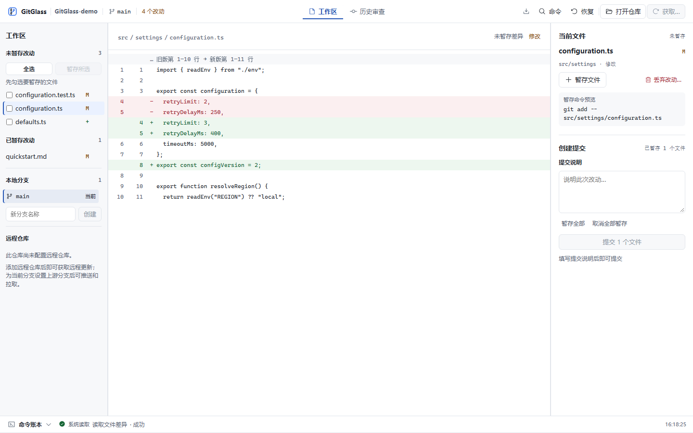
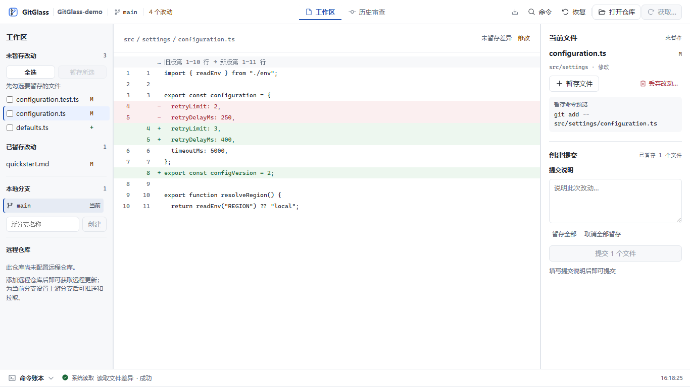
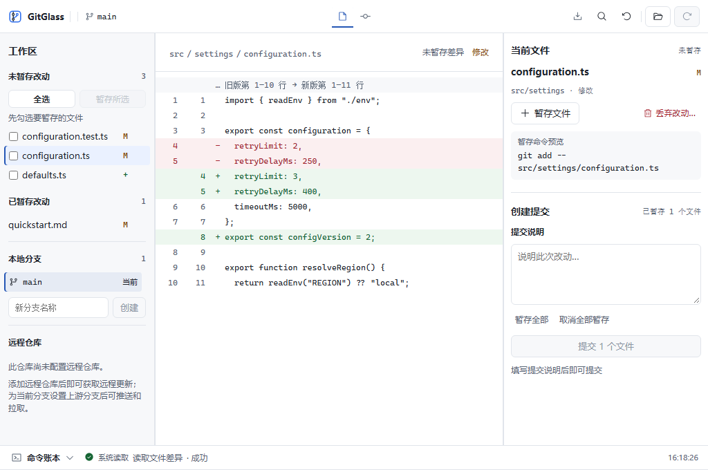
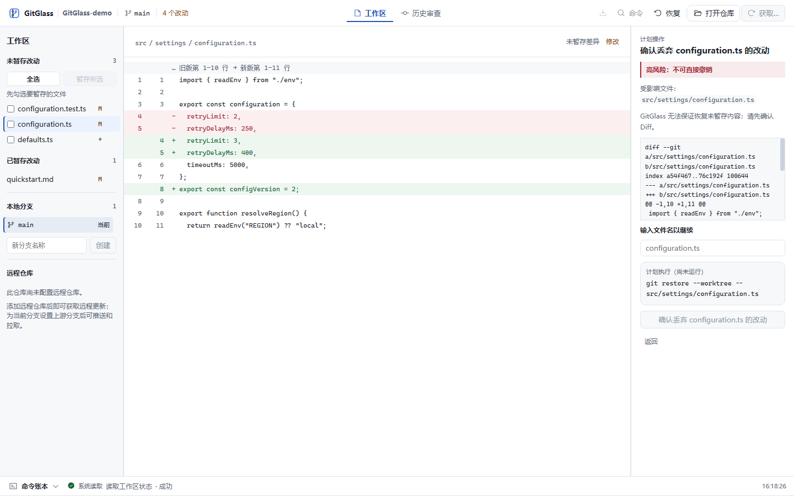
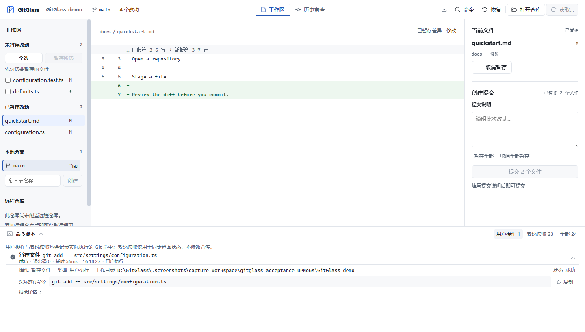

# 工作台改版交付与验收记录

对应交接稿：[ui-redesign-handoff.md](ui-redesign-handoff.md)（设计基线 GitGlass 0.6.7 / `48bc4ec`）。
本文记录这一轮实现的范围、验收证据与复现方式，便于评审时对照。

## 实现范围

P0（首屏动线：选文件 → 看差异 → 暂存 → 提交）与 P1（账本摘要、历史字级、滚动条）一起落地。

| 位置 | 改动 |
| --- | --- |
| [应用工作区布局](../src/main.jsx) | 顶栏拆成三组（品牌 / 视图切换 / 动作），中央单文件标题，右栏固定「当前文件 + 创建提交」两段，账本摘要改取最新用户操作 |
| [工作台组件](../src/workbench-ui.jsx) | `FileRow` 主标签改成 basename + 冲突目录尾段、状态符号固定在行尾；`BatchStageToolbar` 压到两行；`FileInspector` / `CommitInspector` 重做成右栏两段；`PathBreadcrumb`、`DiffContent` 标题去重 |
| [文件展示名](../src/file-labels.js) | 新增纯函数：`basename` / `pathSegments` / `labelFiles`（同名文件补最短可区分父目录尾段）/ `stageSelectionKey(area, path)` |
| [Diff 展示](../src/diff-presentation.js) | `presentDiff(diff, { dropFileHeaderFor })`：工作区单文件且标题与 patch 文件头指向同一路径时才去掉重复头；重命名与多文件结果保留 |
| [账本展示规则](../src/workbench-ledger.js) | 新增 `ledgerGlanceRecord(records, filter)`：优先范围内最近一条用户操作，没有用户操作才回退最近的系统读取 |
| [样式](../src/styles.css) | 0.7 语义变量（画布 / 左栏 / 分隔 / 文字 / 选中 / 增删行）、48px 应用栏、36px 折叠账本、56px Diff 标题条、28px 文件行、右栏两段细线、统一滚动条 |

沿用未改动的部分：Git 命令与 IPC 接口、`计划 → 执行` 的安全校验、命令记录格式、
[面板尺寸模型](../src/panel-resize.js)（左 224 / 190–420、右 296 / 240–420、中央 ≥440，拖动 / 键盘 /
双击复位 / 持久化）、[历史审查](../src/use-history-review.js) 的查询与比较流程。

## 设计变量落地

| 用途 | token | 值 |
| --- | --- | --- |
| 画布、右栏、代码正文 | `--app` / `--surface` | `#FFFFFF` |
| 左栏与局部命令底 | `--sidebar` / `--code` | `#F7F8FA` |
| 面板与组间分隔 | `--line` | `#E1E5EB` |
| 主文字与实心主按钮 | `--text` | `#20252D` |
| 次级文字 | `--muted` | `#586474`（白底约 6.0:1） |
| 选中与焦点 | `--blue` / `--blue-soft` / `--ring` | `#2456B5` / `#EAF1FF` / `#2456B5` |
| 增删行底色 | `--green-wash` / `--red-wash` | `#EDF7EF` / `#FBEFF0` |
| 状态字 | `--green-ink` / `--red-ink` / `--orange-ink` | `#166534` / `#A62632` / `#8B4B11` |
| 字号 | `--font-title` / `--font-body` / `--font-secondary` / `--font-aux` | 14 / 13 / 12 / 11px |
| Diff 正文 | `--font-diff` / `--line-diff` | 12px / 22px |

`--faint`（`#8D97A6`）只用于禁用态与纯装饰，不承载需要阅读的文字。

## 目标尺寸截图

五张截图由真实 Electron 窗口加载 `dist/`、对着真实临时 Git 仓库（3 个未暂存 + 1 个已暂存，
正在审阅 `src/settings/configuration.ts`）拍摄，设备像素比为 1（与设计稿同为 CSS px）。

| 尺寸 | 截图 |
| --- | --- |
| 1440 × 900 |  |
| 1366 × 768 |  |
| 1024 × 680 |  |
| 1440 × 900「丢弃改动」计划态 |  |
| 1440 命令账本展开态 |  |

## 验收反馈修复（2026-11-24）

首轮验收发现四处需要修的问题，改动与回归用例：

| 问题 | 改动 | 回归用例 |
| --- | --- | --- |
| 账本折叠摘要被展开面板的筛选状态带偏：切到「系统读取」再收起，暂存一个文件后底部仍显示系统读取 | `ledgerGlanceRecord(records)` 只看记录本身，不再接收筛选：有用户操作就显示最近一条，没有才回退最近的系统读取；普通操作不改变账本展开状态 | `tests/ui/workbench-structure.test.mjs`「keeps the collapsed summary on the newest user action across filter switches and background refreshes」（系统读取 → 收起 → 暂存 → refs 刷新 → 摘要仍指向暂存）；`tests/unit/workbench-ledger.test.mjs` |
| 含空格路径的暂存预览写成 `git add -- guide for project.md`，账本实际是 `git add -- "guide for project.md"` | 新增 [命令显示模块](../electron/command-display.mjs)，主进程账本与渲染层预览共用一份 `displayGitCommand(argv)`；预览按 argv 构造 | `tests/unit/command-display.test.mjs`；`tests/ui/file-paths.test.mjs`（预览与账本逐字相同）；`tests/integration/git-path-quoting.integration.test.cjs`（真实 Git：只命中选中的文件）；真窗口探针 `stageCheck`（预览命令 === 账本 `displayCommand`） |
| `配置.md` 的 patch 头是八进制转义，界面多出一行乱码文件头；`a/` `b/` 前缀被剥了两次 | [Diff 展示](../src/diff-presentation.js) 解析 Git 的 C 风格引号路径（八进制转 UTF-8），协议前缀只剥一层，去重按解析后的完整仓库相对路径比较；占位空白（含 Git 给含空格路径补的制表符）按协议处理 | `tests/unit/diff-presentation.test.mjs`（引号解码、只剥一次、真实 `a/` 目录、空格路径）；`tests/integration/git-path-quoting.integration.test.cjs`（真实 Git 输出） |
| `new note.md` 与 `new  note.md` 在左栏被折叠成同一个名字 | [文件展示名](../src/file-labels.js) 不再压平空白：显示名、目录尾段、`title` 与 `aria-label` 都保留原始空白；暂存键仍是原始 `area + path` | `tests/ui/file-paths.test.mjs`（两行分别是两个路径、分别暂存命中各自路径）；`tests/unit/file-labels.test.mjs` |
| 新窗口探针用固定延时等布局、焦点和 Diff | 全部改成轮询目标状态：布局（innerWidth/innerHeight/标题 56px）、焦点回到文档、Diff 内容与选中行对应当前文件；计划取消时比较文件内容 + 暂存区 + 工作区三份快照 | `tests/ui/workbench-window.test.cjs`（`diffShowsSelectedFile`、`diffSelectedRows`、`plan.statusUnchanged`、`stageCheck`） |

## 验收结果

复现命令：

```powershell
npm run build
npm run test        # 含 tests/ui/workbench-window.test.cjs（真窗口 + 真实仓库，三个尺寸）
npm run lint
npm run typecheck
npm run test:coverage
```

`tests/support/workbench-acceptance.cjs` 会建一个临时仓库、按三个尺寸测量并把截图写到
`.screenshots/ui-redesign/`；`tests/ui/workbench-window.test.cjs` 把下面的数字断言成测试。

| 场景 | 通过条件 | 结果 |
| --- | --- | --- |
| 1440×900 / 1366×768 / 1024×680 | 顶栏与原生窗口控件互不覆盖 | 顶栏高度恒为 48px，动作组右边界止于窗口宽度 −16px（1024 时 −12px）；WCO 安全区仍由 `padding-right: env(titlebar-area-*)` 让出 |
| 同上 | 默认可见 Diff 和提交区标题 | 三档尺寸下 Diff 标题条 56px、提交区标题与按钮均在首屏内 |
| 同上 | 键盘能到达提交与计划按钮 | 填好说明后从说明框按 Tab：`暂存全部 → 取消全部暂存 → 提交 N 个文件`；计划态 `返回` 可聚焦 |
| 同名文件、超长路径、同路径跨区域 | 同名项可辨认、长路径不推宽面板、暂存 / 取消暂存命中正确 area + path | 单测覆盖 `labelFiles` 与 `stageSelectionKey(area, path)`；1024 下侧栏与中央标题无横向溢出 |
| 草稿保留、批量暂存、计划进出 | 草稿保留、数量准确、同一时刻只有一个高权重常规动作 | `tests/ui/batch-stage-ui.test.mjs`、`tests/ui/workbench-structure.test.mjs` 真渲染覆盖 |
| 二进制、重命名、截断、多文件历史对比 | 保留原 / 新路径与文件边界，不编造增删数 | `tests/unit/diff-presentation.test.mjs`（重命名与多文件保留文件头）、既有历史用例不变 |
| 丢弃计划 → 返回；分支 / 远程计划 | 明确「尚未运行」，返回后仓库无变化 | 探针实测 `计划执行（尚未运行）`、`高风险：不可直接撤销`、`git status` 前后一致 |
| 用户操作后被外部 Git 刷新，再展开账本 | 折叠状态保留，摘要仍能找到刚完成的操作 | `ledgerGlanceRecord` 单测 + 渲染用例「prefers the newest user action…」 |
| 无仓库、干净仓库、第一个提交之前 | 空状态只有必要动作；无 HEAD 的取消暂存可用且预览不猜命令 | 无仓库时右栏只有引导块；取消暂存不显示命令预览（参数不可确定时界面不展示） |
| 仅用键盘操作三个面板与账本 | 可见焦点、左侧复选与文件选择独立、分隔条可调、账本快捷键可用 | 焦点环统一 2px；`Ctrl+J` / `Ctrl+K` / `Ctrl+F` 行为不变；分隔条键盘步进由既有探针覆盖 |

本次实测：`npm test` 425 通过 / 2 个既有失败；`npm run lint`、`npm run typecheck` 0 error；
覆盖率（排除下面两个既有失败用例）statements 78.9% / branches 72.77% / functions 77.31% / lines 81.7%，门槛 50%。

已知的既有失败（与本次改动无关，改动前 `npm test` 同样红）：

1. `tests/integration/repository-watcher.integration.test.cjs` 的「fetch 更新 200 个远程跟踪引用」等待超时（本机时序）。
2. `tests/ui/electron-shell.test.cjs` 断言打包产物版本号，`release/win-unpacked` 里仍是 0.6.6 的旧包，需重新 `npm run dist:win`。

## 未能自动化的部分

- **Windows 125% 缩放**：探针按 CSS px 布局，缩放属于 Chromium 的 DPI 处理，需要人工在 125% 系统缩放下目视确认顶栏与原生控件间距。
- **真实窗口控件叠加**：探针窗口自带原生标题栏（仓库规范禁止模拟外壳），WCO 安全区只在 `tests/ui/style-contracts.test.cjs` 里以样式契约守住。
- **Diff 增删统计与按块暂存**：交接稿列为后续项，本轮未实现，界面也不显示无法确认的增删数字。

## 后续（不在本次范围）

- README 工作区和命令账本截图均来自本次改版的实机验收，使用独立的演示仓库。
- `docs/design.md` 里关于工作区默认历史图、隐藏提交表单、账本自动展开的旧描述按交接稿只作演进背景，未同步改写。
