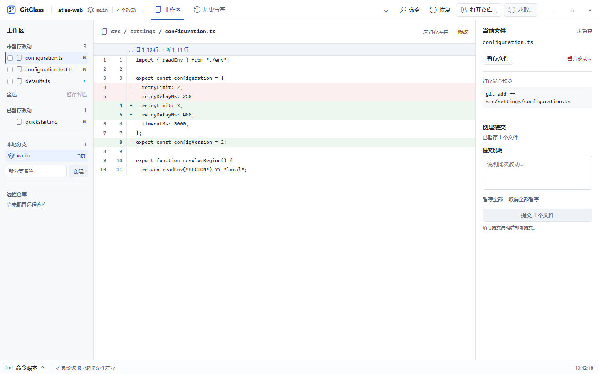
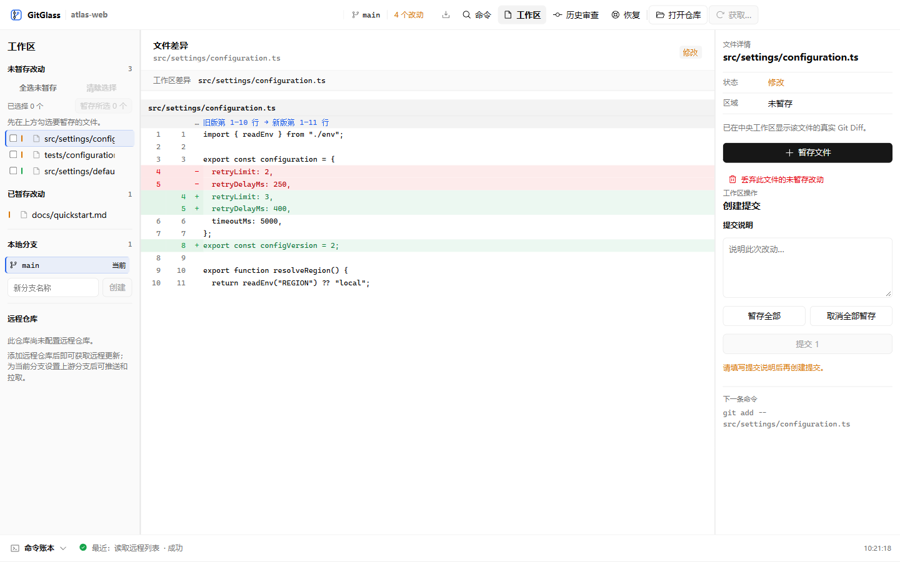

# GitGlass 工作台 UI 改版交接稿

设计基线为 GitGlass 0.6.7，提交 `48bc4ec`。这轮把用户最常走的「选文件 → 看差异 → 暂存 → 提交」做得更容易扫读。沿用 DBX 的紧凑列表、连续面板和细分隔线，把 GitGlass 的识别点放在 Diff、动作预览与底部命令账本。 [DBX 中文项目说明](https://github.com/t8y2/dbx/blob/main/README.zh-CN.md) · [DBX 桌面端设计变量](https://github.com/t8y2/dbx/blob/main/apps/desktop/src/styles/tokens.css)

## 目标稿与现状

目标稿使用 `1440 × 900` CSS px。示例仓库里有 3 个未暂存文件、1 个已暂存文件，正在审阅 `src/settings/configuration.ts`。目标稿为静态视觉参考，交互和不同状态以本文规格为准。

查看同一临时仓库在当前版本中的实际截图

## 改动优先级

| 优先级 | 改动 | 完成后的体验 |
| --- | --- | --- |
| P0 | 右栏明确区分当前文件和提交区 | 一眼分清「只影响这个文件」和「影响整个暂存区」，能马上找到提交。 |
| P0 | Diff 单一标题与左侧文件列表 | 选定文件后直接读代码，窄栏仍能认出文件，查看同名文件时能定位目录。 |
| P0 | 顶栏、字号、分隔和窗口适配 | 首屏更聚焦，浅灰表面、选中态和命令字体在各面板语义一致。 |
| P1 | 命令账本摘要、历史审查与滚动细节 | 后台刷新过后仍能看到最近一次用户操作，历史和长列表更易扫读。 |
| 后续 | Diff 增删统计、按块暂存 | 增删统计依赖完整、可信的数据。按块暂存单独设计 Git 交互和验收。 |

## P0 视觉与布局

延用项目的系统字体和现有图标库。界面字体用 Windows 本地无衬线与中文回退，代码、路径、SHA 和命令沿用本地等宽字体。面板标题 `14px/600`，正文 `13px`，说明 `12px`，时间和快捷键提示 `11px`。Diff 正文 `12px`，行高 `22px`。优先修改现有语义变量，避免在每个组件重新定义同一颜色。

| 用途 | 目标值 |
| --- | --- |
| 画布、右栏、代码正文底色 | `#FFFFFF` |
| 左栏和局部命令底色 | `#F7F8FA` |
| 面板及组间分隔 | `#E1E5EB` |
| 主文字与实心主按钮 | `#20252D` |
| 次级文字 | `#586474` |
| 选中和焦点 | `#2456B5` / 选中底 `#EAF1FF` |

- 增删行底色用 `#EDF7EF` / `#FBEFF0`，与行号、`+`、`−` 同时显示。状态字可用深绿 `#166534`、深红 `#A62632`、深橙 `#8B4B11`。只给实际变更行上色。
- 应用栏 `48px`，顶栏按钮 `30–32px`，文件行 `28px`。普通控件圆角 `6px`，面板以直线相接。间距采用 `4 / 8 / 12 / 16 / 24px`。中央单文件标题条约 `56px`。
- 保留面板宽度模型。左栏默认 `224px`、范围 `190–420px`，右栏默认 `296px`、范围 `240–420px`，中央给 Diff 至少 `440px`，两条分隔线各 `1px`。拖动、键盘调节、双击复位及持久化复用现有逻辑。
- 顶栏分三组。左侧是品牌、仓库、分支和改动状态，中段是「工作区 / 历史审查」，右侧是命令、恢复、打开仓库、获取和更新入口。当前视图用蓝色下划线与选中语义。保留 Windows 原生窗口控件和可拖拽区，`1240px` 以下复用图标折叠，必要时优先省略仓库名和状态文本。图标入口保留可访问名称与提示。
- 工作区开着账本时仍由各面板独立滚动。全局没有横向滚动条。Diff 长行只滚动代码区域，计划的确认和返回在右栏内始终可达。焦点环 `2px`，可见文本与底色至少 `4.5:1`，状态语义同时通过文字或符号表达。

### 右栏

右栏内边距 `16px`。「当前文件」区显示文件名、所属区域、暂存或取消暂存。保留符合条件的「丢弃改动…」为低权重红字动作，始终处于文件区内。文件区到「创建提交」用细线隔开，线上约 `18px`，线下约 `16px`。只保留动作所需的信息，移除「已在中央显示差异」等重复说明。

「创建提交」依次显示标题、已暂存文件数、提交说明、紧凑的批量操作、提交按钮和必要的状态提示。说明文本框保留可见标签，目标初始高度 `82–96px`，窗口较窄时右栏可滚动。「提交 1 个文件」直接来自已暂存数量。无暂存时提示「先暂存要提交的文件」，有暂存但说明为空时提示「填写提交说明后即可提交」。

| 场景 | 主操作 |
| --- | --- |
| 暂存区为空，当前文件可暂存 | 「暂存文件」用实心样式，引导完成第一步。 |
| 暂存区已有文件，提交说明为空 | 提交按钮保持禁用并显示原因。单文件暂存仍可用，使用描边样式。 |
| 暂存区已有文件，提交说明有效 | 「提交 N 个文件」为当前唯一常规实心动作。 |
| 进入操作计划 | 确认按钮随现有风险等级呈现，返回仍可见，其他操作按现有规则处理。 |

命令预览跟随动作。可暂存的当前文件在文件区显示「暂存命令预览」，可以提交时在提交区显示「提交命令预览」。用单独标题区分两种上下文。有条件分支的命令只在现有状态能确定参数时展示。例如无 HEAD 仓库的取消暂存有不同命令，界面应避免猜测。预览只用于展示，提交草稿在选择文件、暂存及打开或退出计划时沿用现有管理逻辑。

### 左栏文件列表

- 主标签显示 basename，完整相对路径保留在悬停提示和可访问名称中。同一分组出现同名文件时，从最短可区分的父目录尾段开始补充，按需显示 `configuration.ts  test/settings/` 一类后缀。逐步扩展冲突路径，必要时回退完整相对路径。
- 文件状态用一致的符号位置表达，例如 `M`、`+`、`−`。选中用浅蓝底与左侧 `2px` 蓝条。行级操作和复选框仍是独立按钮或输入控件。保留行操作空间，悬停或键盘聚焦时行宽不跳变。
- 将批量暂存区压到两行以内。未选中时显示「全选」「暂存所选」，后者禁用。选中后显示数量、清除入口和暂存动作。显示标签与操作标识分离，使用原始 `area + path` 寻址，包括同一个文件在两个区域同时出现的情况。

### 中央 Diff

- 普通工作区文件只保留一条标题，面包屑承载路径，右侧放「未暂存差异 / 已暂存差异」以及文件状态。保留可访问的「文件差异」标题。文件路径过长时先省略前面的目录，允许通过提示读取完整相对路径。
- 去重只针对工作区普通单文件，并且标题与 patch 的文件头确认指向同一路径。保留重命名的「旧路径 → 新路径」、多文件历史结果的独立文件头、权限修改、二进制及末尾无换行等元信息。长代码继续局部横向滚动。
- 加载、无文本差异、二进制、失败和截断沿用现有区分。失败与截断保留现有诊断入口。增删数只有在能确认是完整统计时才显示，二进制或截断场景保留真实状态。
- 无仓库时提供一个明显的「打开仓库」入口。干净仓库保留简短状态和通往历史审查的提示。工作区有文件但未选中时引导选文件。

## P1 账本、历史与滚动

- **命令账本折叠高 `36px`。** 取当前账本范围内最近一条用户操作作为摘要，显示来源、意图、结果和时间。还没有用户操作时回退最近的系统读取。摘要点击展开后选择相应来源。普通操作保持用户当前的折叠状态。保留打开或刷新失败时的诊断例外及 `Ctrl+J`。
- **展开保留两行摘要结构。** 第一行是意图和等宽命令，第二行是结果、退出码、耗时、时间和来源。用户操作、系统读取和全部计数仍可切换。详情保留原始 argv、cwd、stdout、stderr、退出码与复制入口。计划使用现有「计划执行（尚未运行）」文案，本地拒绝沿用现有拒绝状态。
- **历史审查统一字级和选中态。** 提交说明优先，SHA、作者、时间在第二层。保留已有筛选、文件历史和「基准 → 对比」方向。模式切换继续使用现有工作区和历史状态。
- **滚动条统一到现有滚动容器。** 使用约 `8px` 轨道、透明轨道、可辨识且悬停加深的滑块。保留拖动、滚轮、键盘和高对比环境下的原生行为。

## 开发位置与验收

这轮实现集中于 [应用工作区布局](../src/main.jsx)、[工作台组件](../src/workbench-ui.jsx) 和 [样式](../src/styles.css)。优先复用 [Diff 展示](../src/diff-presentation.js)、[面板尺寸](../src/panel-resize.js) 和 [账本展示规则](../src/workbench-ledger.js)。Git 命令、IPC 接口、记录格式和安全校验沿用现有实现。以实际代码和 [0.6.7 更新记录](../CHANGELOG.md) 为行为基线，[原设计文档](design.md) 里关于工作区默认历史图、隐藏提交表单和账本自动展开的旧文字仅作演进背景。[已有 UI 反馈](improvement-plan.md#066-beta1-验收反馈2026-11-20用户提出)

| 场景 | 通过条件 |
| --- | --- |
| 普通仓库，窗口为 `1440×900`、`1366×768`、`1024×680` | 顶栏与原生窗口控件互不覆盖，默认可见 Diff 和提交区标题。在最小窗口检查键盘能到达提交与计划按钮。再检查 Windows 125% 缩放。 |
| 同名文件、超长路径、已暂存和未暂存同时存在的同一路径 | 同名项能辨认位置，长路径不会推宽面板，暂存与取消暂存操作命中正确区域和路径。 |
| 在提交说明有草稿时切文件、单个暂存、多选暂存或打开、退出计划 | 草稿保留，暂存数量准确，提交内容只包含已经进入暂存区的改动。准备好之后同一时刻只有一个高权重常规执行按钮。 |
| 二进制、重命名、输出截断、多文件历史对比 | 保留实际提示、原路径和新路径，多个文件边界清楚。无法确认的增删数字没有占位值。 |
| 查看丢弃计划后返回，检查一次分支或远程计划 | 明确出现「尚未运行」，返回时仓库无变化，确认词、阻断条件、再校验和实际命令与当前规则一致。 |
| 完成一次用户操作后触发外部 Git 刷新，再展开账本 | 折叠状态保留，P1 摘要仍可找到刚完成的操作。来源筛选与原始记录匹配，详情可复制。 |
| 无仓库、干净仓库和第一次提交之前 | 空状态只有必要动作。无 HEAD 分支的取消暂存继续可用，预览无错误命令。 |
| 仅用键盘操作三个面板和账本 | 可见焦点、左侧复选和文件选择可独立使用，分隔条可调、账本快捷键可用，文字与长代码区域可滚动。 |

**给开发 AI 的任务说明**

> 先按本文 P0 实现 GitGlass 工作区。以目标图为视觉参考，以状态表为行为规格。复用已有 React 组件、Git 操作和安全计划。使用真实的临时 Git 仓库验证 P0 场景，附三个目标尺寸的界面截图和运行过的相关检查。P1 可拆为第二个可独立评审的改动。
